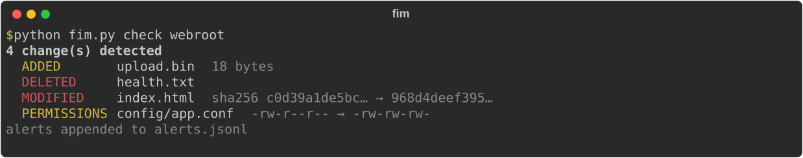
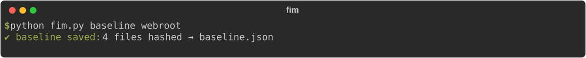
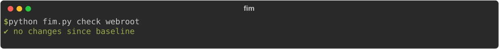

# File Integrity Monitor (FIM)

**Quick summary:** A Python tool that fingerprints every file in a folder with SHA-256, then alerts when anything is added, deleted, modified, or has its permissions changed. It's the same idea behind Tripwire, OSSEC/Wazuh FIM, and the PCI-DSS file-monitoring requirement.



## Description
1. **Baseline:** hash every file and save hashes, sizes, and permissions to `baseline.json`.
2. **Check:** re-hash and compare. Any difference becomes an alert on screen and a JSON line in `alerts.jsonl` (ready to ship to a SIEM).
3. **Watch:** repeat the check on an interval for continuous monitoring.

| Baseline | Nothing changed |
|---|---|
|  |  |

In the demo above, a web root was tampered with: the homepage was defaced, an unexpected file appeared, a health-check file was deleted, and a config file became world-writable. All four changes were caught.

## Tools Used
- **Python** standard library: `hashlib` (SHA-256), `os.walk`, `stat`, `json`, `argparse`
- Tests with temporary directories (`test_fim.py`)

## Scope
Local folders, polling-based. Real-time OS file events, remote agents, and tamper-proof storage of the baseline are future work.

## Objective
Build a core **detective control** from the CIA triad's *Integrity* pillar, and understand how hashing lets you prove a file hasn't changed.

## Result
- Detects all 4 change types, with zero false positives on unchanged files (both covered by tests).
- Streams large files in 64 KB chunks, so memory stays flat no matter the file size.
- Alerts are structured JSON, e.g. `{"time": "...", "event": "MODIFIED", "path": "index.html", "detail": "sha256 c0d3… → 968d…"}`.

## What I Learned
- **Why SHA-256:** changing a single bit produces a completely different hash, and nobody can craft a different file with the same hash. Timestamps alone are useless because attackers can reset them.
- **Permission changes matter:** a config going from `rw-r--r--` to `rw-rw-rw-` means any local user can edit it, a classic privilege-escalation setup.
- **Protect the baseline:** if attackers can edit `baseline.json`, they can hide their changes. In production it belongs on read-only or separate storage.
- Skipping symlinks and handling unreadable files avoids crashes and loops.
- Detection is only useful if someone sees it, which is why the alerts are logged as JSON.

## Run It
```bash
python fim.py baseline /path/to/folder
python fim.py check /path/to/folder
python fim.py watch /path/to/folder --interval 10
python test_fim.py
```
